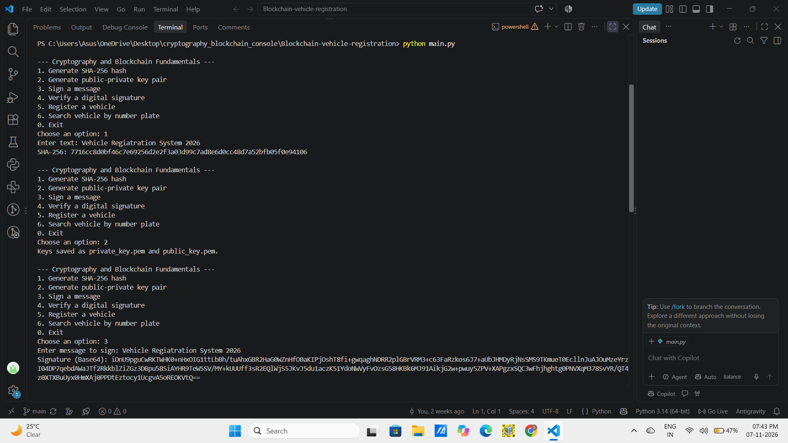
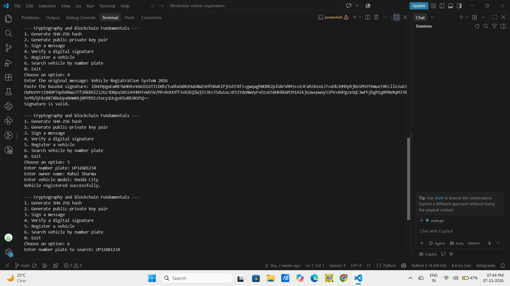
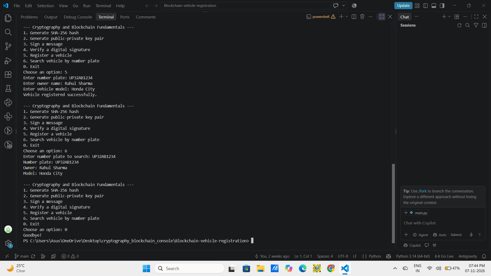

# Cryptography and Blockchain Fundamentals Assignment

A simple menu-driven Python console program for:

- SHA-256 hashing
- RSA public/private key generation
- Digital message signing and signature verification
- Vehicle registration and number-plate lookup
- Input validation and duplicate plate prevention

## Requirements

- Python 3.10+
- `cryptography` library

## Run the program

1. Open this folder in VS Code.
2. Install the required library:

   ```bash
   pip install -r requirements.txt
   ```

3. Run:

   ```bash
   python main.py
   ```

## Notes

- Vehicle details are saved in `vehicles.json`, so they remain available after restarting the program.
- Key generation creates `private_key.pem` and `public_key.pem` in the current folder.
- Keep `private_key.pem` secret. Do not upload your private key or personal vehicle data to GitHub.
- This is a learning assignment, not a production vehicle registration system.
---

Project Output Screenshots

The following screenshots demonstrate the working outputs of the Blockchain-Based Vehicle Registration System.

1. SHA-256 Hash Generation




2. Digital Signature




3. Vehicle Registration

